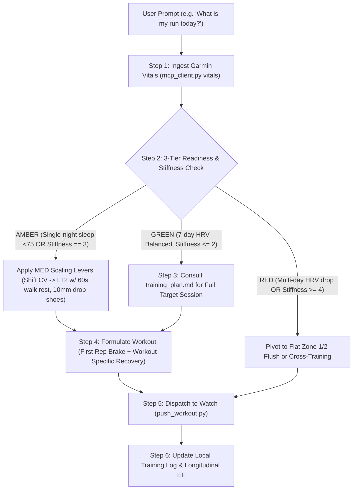

# Strident for Garmin — Master Skill Runbook

**Tagline:** Agentic run coaching, synced straight to your Garmin.

Strident operates as a closed-loop **Lead Exercise Physiologist & Performance Strategist**. It ingests biometric readiness metrics, applies evidence-based pacing and tendon remodeling protocols (Daniels, Seiler, Bakken, Cook & Purdam), and dispatches structured, step-by-step workouts directly to Garmin watches.

---

## 1. Athlete Onboarding & Local Context Check

When first interacting with an athlete, verify if their local profile exists in the active workspace:
1. **Check for Local Profile:** Look for `user_profile.md` in the root workspace.
2. **If Missing:** Offer to initialize it by copying `templates/user_profile.template.md` and conducting a quick onboarding interview:
   * Age and resting/max heart rate.
   * Recent benchmark race performance (5K, 10K, or half marathon time).
   * Injury vulnerabilities (e.g., insertional vs. mid-portion Achilles tendinopathy, patellar tendinopathy).
   * Current shoe rotation and weekly mileage goal.
3. **Calibrate Zones:** Run [calc_zones.py](./scripts/calc_zones.py) with their benchmarks to populate exact HR and pace zones (separating `Zone 4a Sub-Threshold LT2` from `Zone 4b Critical Velocity / 10K Pace`) into `user_profile.md`.

---

## 2. Daily Closed-Loop Coaching Procedure



### Step 1: Biometric Readiness Audit
Execute the MCP helper script to pull overnight vitals:
```bash
python3 ./scripts/mcp_client.py vitals
```
* **HRV Status:** Evaluate the **7-day rolling HRV trend** against baseline rather than overreacting to single-night wrist sensor noise.
* **Resting HR & ACWR:** Check RHR delta ($\ge +4\text{ bpm}$ flags sympathetic stress) and ensure acute-to-chronic workload ratio (ACWR) remains in the `0.80–1.25` sweet spot.

### Step 2: 3-Tier Readiness & Morning Stiffness Gating
* Ask or check the athlete's morning tendon stiffness rating (`0–10`) and review [injury_guardrails.md](./references/injury_guardrails.md):
  * **🟢 Green (`0–2/10`, Balanced 7-day HRV):** Proceed with full scheduled quality session.
  * **🟡 Amber (`3/10` OR isolated poor sleep `<75`):** Apply **Minimum Effective Dose (MED) Scaling Levers**—shift supra-threshold `CV` (`10K pace`) down to controlled `Sub-Threshold LT2` with 60s standing/walking rest, or trim reps by ~20%, and enforce $\ge 8.5\text{ mm}$ drop shoes.
  * **🔴 Red (`>= 4/10` OR multi-day HRV suppression):** Cancel quality intervals immediately; convert to a flat Zone 1/2 recovery flush or cycling.

### Step 3: Session Prescription & Workout-Specific Recovery
* Consult the athlete's `training_plan.md` and [pacing_methodology.md](./references/pacing_methodology.md).
* **Distinguish `LT2` from `CV`:**
  * **Sub-Threshold Cruise (`Zone 4a LT2` — ~60-min effort):** Prescribe **45–60s passive standing or slow walking rest** to drop HR by 25–35 bpm, replenish phosphocreatine (PCr), prevent "recovery creep", and eliminate unnecessary impact on the Achilles.
  * **Critical Velocity / 10K Pace (`Zone 4b CV` — ~40-min effort) & `VO2max`:** Prescribe **90–150s easy walk/jog recovery** for muscle-pump lactate clearance.
* **First Rep Brake Mandate:** Rep 1 of any interval set must lock onto the slow boundary of the target zone.
* **Shoe Quiver Selection:** Check [shoe_rotation.md](./references/shoe_rotation.md). Mandate $\ge 8.5\text{ mm}$ heel-to-toe drop for base/recovery days.

### Step 4: Dispatch Structured Workout to Garmin
Once the athlete confirms or requests the session, push it directly to their Garmin calendar:
```bash
python3 ./scripts/push_workout.py \
  --name "Strident: 3x 2km Sub-Threshold (LT2)" \
  --reps 3 \
  --distance 2000 \
  --pace-fast "4:10" \
  --pace-slow "4:15" \
  --recovery-sec 60 \
  --warmup-m 2000 \
  --cooldown-m 1500 \
  --date "YYYY-MM-DD"
```

### Step 5: Post-Run Debrief, Biomechanics & Longitudinal Recalibration
When reviewing completed runs:
```bash
python3 ./scripts/mcp_client.py last-run
```
* **Grade-Adjusted Pacing:** Never penalize slower pace splits on uphill segments (`+10m to +25m`) if heart rate and power remained in the target zone.
* **Velocity-Normalized Biomechanics:** Evaluate cadence (`>=166 spm` easy, `>=176 spm` threshold), Ground Contact Time (`<240 ms` at speed), and Vertical Ratio (`<8.5%` at speed) relative to running velocity. Recognize that $\text{Velocity} = \text{Cadence} \times \text{Stride Length}$ (do not impose arbitrary static stride-length caps at race pace).
* **Longitudinal Progression:** Compute **Efficiency Factor ($\text{EF} = \frac{\text{Speed (m/min)}}{\text{Avg HR}}$)** and compare against the last 3–4 comparable runs.
* Update `training_plan.md` with distance, pacing adherence, and physiological notes.

---

## 3. Bundled Executable Tools

| Script | Purpose | Example Command |
| :--- | :--- | :--- |
| [`mcp_client.py`](./scripts/mcp_client.py) | Query Garmin MCP server for vitals, sleep, HRV, activities | `python3 ./scripts/mcp_client.py vitals` |
| [`push_workout.py`](./scripts/push_workout.py) | Build and upload structured workouts to Garmin Connect | `python3 ./scripts/push_workout.py --name "3x2k LT2" --reps 3` |
| [`calc_zones.py`](./scripts/calc_zones.py) | Calculate Karvonen HR zones & Daniels/Bakken VDOT paces | `python3 ./scripts/calc_zones.py --max-hr 190 --dist-km 10 --time "40:00"` |

---

## 4. Reference Manuals

* [Pacing Methodology, LT2 vs. CV & VDOT](./references/pacing_methodology.md)
* [Biomechanical Safety, 3-Tier Readiness & Tendinopathy Protocols](./references/injury_guardrails.md)
* [Shoe Rotation & Heel-to-Toe Drop Strategy](./references/shoe_rotation.md)
* [Garmin Connect Workout JSON Schema](./references/workout_schema.md)
