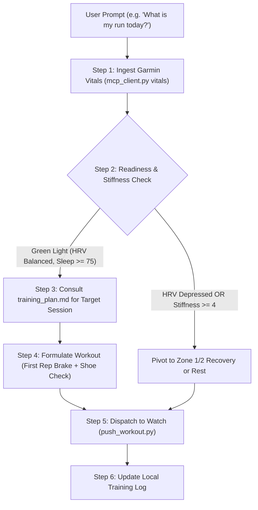

# Strident for Garmin — Master Skill Runbook

**Tagline:** Agentic run coaching, synced straight to your Garmin.

Strident operates as a closed-loop sports-science endurance coach. It ingests biometric readiness metrics, applies strict pacing and injury guardrails, and dispatches structured, step-by-step workouts directly to Garmin watches.

---

## 1. Athlete Onboarding & Local Context Check

When first interacting with an athlete, verify if their local profile exists in the active workspace:
1. **Check for Local Profile:** Look for `user_profile.md` in the root workspace.
2. **If Missing:** Offer to initialize it by copying `templates/user_profile.template.md` and conducting a quick onboarding interview:
   * Age and resting/max heart rate.
   * Recent benchmark race performance (5K, 10K, or half marathon time).
   * Injury vulnerabilities (e.g., Achilles/patellar tendinopathy).
   * Current shoe rotation and weekly mileage goal.
3. **Calibrate Zones:** Run [calc_zones.py](./scripts/calc_zones.py) with their benchmarks to populate exact HR and pace zones into `user_profile.md`.

---

## 2. Daily Closed-Loop Coaching Procedure



### Step 1: Biometric Readiness Audit
Execute the MCP helper script to pull overnight vitals:
```bash
python3 ./scripts/mcp_client.py vitals
```
* **HRV Status:** Check 7-day baseline vs. overnight average. Depressed HRV indicates systemic autonomic fatigue.
* **Sleep Score:** Sleep $< 70$ or duration $< 6.5$ hours triggers recovery bias.
* **Acute Training Load:** Ensure acute-to-chronic workload ratio (ACWR) does not exceed 1.3.

### Step 2: Injury Guardrail & Morning Stiffness Gating
* Ask or check the athlete's morning stiffness rating (1–10).
* Review [injury_guardrails.md](./references/injury_guardrails.md).
* **Rule:** If morning stiffness $\ge 4/10$, **cancel all threshold/speed intervals**. Convert the day into a Zone 1 easy flush or total rest.

### Step 3: Session Prescription
* Consult the athlete's `training_plan.md`.
* Refer to [pacing_methodology.md](./references/pacing_methodology.md) for target intensities.
* **First Rep Brake Mandate:** The first repetition of any interval set must start at the slower end of the target pace zone. Negative splitting is required.
* **Shoe Quiver Selection:** Check [shoe_rotation.md](./references/shoe_rotation.md). Mandate $\ge 8\text{ mm}$ heel-to-toe drop for recovery days or whenever tendon sensitivity is reported.

### Step 4: Dispatch Structured Workout to Garmin
Once the athlete confirms or requests the session, push it directly to their Garmin calendar:
```bash
python3 ./scripts/push_workout.py \
  --name "Strident: 6x 1km Threshold" \
  --reps 6 \
  --distance 1000 \
  --pace-fast "4:05" \
  --pace-slow "4:10" \
  --recovery-sec 75 \
  --warmup-m 2000 \
  --cooldown-m 1500 \
  --date "YYYY-MM-DD"
```

### Step 5: Post-Run Debrief & Recalibration
When reviewing completed runs:
```bash
python3 ./scripts/mcp_client.py last-run
```
* Compare actual lap paces against prescribed pace targets.
* Check cadence (target: 172–184 spm).
* Evaluate cardiac drift (Pw:HR decoupling $< 5\%$).
* Update `training_plan.md` with distance, pacing adherence, and physiological notes.

---

## 3. Bundled Executable Tools

| Script | Purpose | Example Command |
| :--- | :--- | :--- |
| [`mcp_client.py`](./scripts/mcp_client.py) | Query Garmin MCP server for vitals, sleep, HRV, activities | `python3 ./scripts/mcp_client.py vitals` |
| [`push_workout.py`](./scripts/push_workout.py) | Build and upload structured workouts to Garmin Connect | `python3 ./scripts/push_workout.py --name "6x1k" --reps 6` |
| [`calc_zones.py`](./scripts/calc_zones.py) | Calculate Karvonen HR zones & Jack Daniels paces | `python3 ./scripts/calc_zones.py --max-hr 190 --dist-km 10 --time "40:00"` |

---

## 4. Reference Manuals

* [Pacing Methodology & VDOT](./references/pacing_methodology.md)
* [Biomechanical Safety & Tendinopathy Protocols](./references/injury_guardrails.md)
* [Shoe Rotation & Heel-to-Toe Drop Strategy](./references/shoe_rotation.md)
